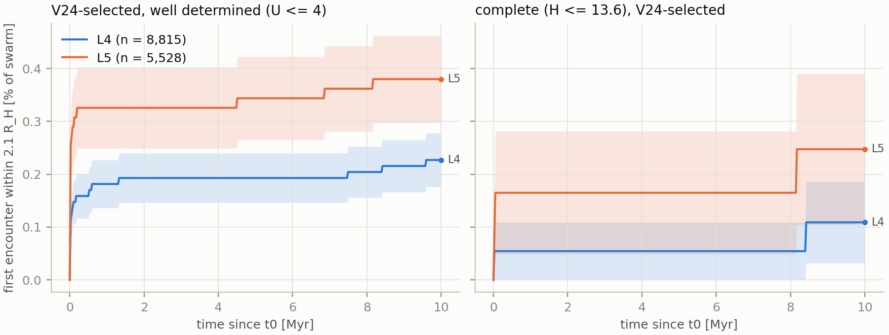
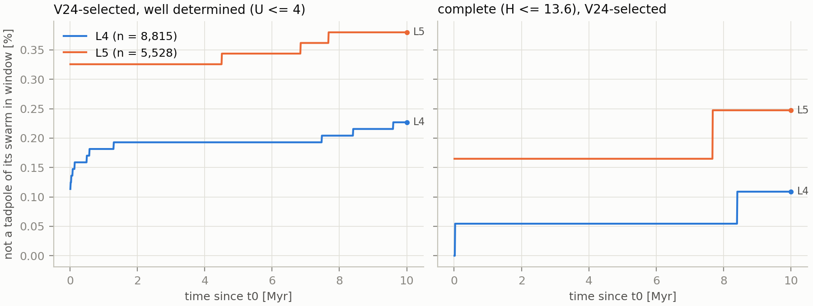
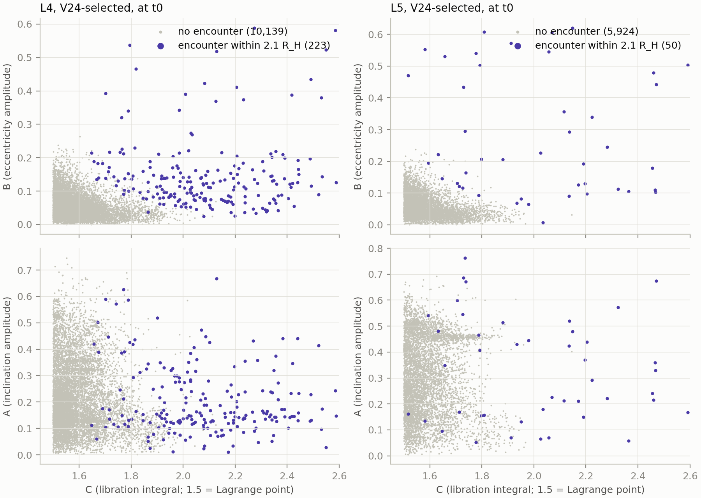

# pilot_10myr

16,445 Trojans integrated for 10.0002 Myr (dt = 0.11861 yr, sampled every 8 steps). No clones: errors are binomial over objects and include each trajectory's chaotic scatter. This is a 10.0002 Myr run, not a 4.5 Gyr erosion rate.

## Encounters with the giants

`encounter_2.1RH`: first entry within 2.1 Hill radii (Di Sisto 2019's escape criterion). `removed_1RH`: entry within 1 Hill radius (Di Sisto 2014's), where the particle is removed.

**Read the orbit-quality row, not the raw one.** Objects with JPL condition code >= 5 escape at percent level here, and L4 carries twice L5's share of them (mostly recent discoveries with short arcs), so the raw sample shows an L4 excess that is an observational artefact rather than dynamics.

| sample | swarm | n | encounter_2.1RH | frac_2.1RH | err_2.1RH | removed_1RH | frac_1RH |
|---|---|---|---|---|---|---|---|
| all integrated | L4 | 10,446 | 305 | 0.0292 | 0.0016 | 302 | 0.0289 |
| all integrated | L5 | 5,999 | 75 | 0.0125 | 0.0014 | 74 | 0.0123 |
| V24-selected | L4 | 10,362 | 223 | 0.0215 | 0.0014 | 220 | 0.0212 |
| V24-selected | L5 | 5,974 | 50 | 0.0084 | 0.0012 | 50 | 0.0084 |
| V24-selected, well determined (U <= 4) | L4 | 8,815 | 20 | 0.0023 | 0.0005 | 20 | 0.0023 |
| V24-selected, well determined (U <= 4) | L5 | 5,528 | 21 | 0.0038 | 0.0008 | 21 | 0.0038 |
| complete (H <= 13.6), V24-selected | L4 | 1,836 | 2 | 0.0011 | 0.0008 | 2 | 0.0011 |
| complete (H <= 13.6), V24-selected | L5 | 1,213 | 3 | 0.0025 | 0.0014 | 3 | 0.0025 |
| Di Sisto 2013 numbered | L4 | 1,974 | 1 | 0.0005 | 0.0005 | 1 | 0.0005 |
| Di Sisto 2013 numbered | L5 | 999 | 3 | 0.0030 | 0.0017 | 3 | 0.0030 |

## The asymmetry

`amplifier S4/S5` = (1 - f4) / (1 - f5) is Di Sisto's erosion amplifier: the factor by which this run multiplies N4/N5. For reference, over 4.5 Gyr Di Sisto 2014 got 1.071 +- 0.025 and Di Sisto 2019 got 1.020 +- 0.023. Errors are binomial, propagated in quadrature, and are only indicative where a swarm has a handful of escapers.

| sample | N4/N5 at t0 | N4/N5 at t_end | escape ratio L5/L4 | escape ratio err | amplifier S4/S5 | amplifier err | n_escapers L4+L5 |
|---|---|---|---|---|---|---|---|
| all integrated | 1.7413 | 1.7119 | 0.4282 | 0.0548 | 0.9831 | 0.0022 | 380 |
| V24-selected | 1.7345 | 1.7115 | 0.3889 | 0.0605 | 0.9867 | 0.0019 | 273 |
| V24-selected, well determined (U <= 4) | 1.5946 | 1.5971 | 1.6743 | 0.5223 | 1.0015 | 0.0010 | 41 |
| complete (H <= 13.6), V24-selected | 1.5136 | 1.5157 | 2.2704 | 2.0709 | 1.0014 | 0.0016 | 5 |
| Di Sisto 2013 numbered | 1.9760 | 1.9809 | 5.9279 | 6.8411 | 1.0025 | 0.0018 | 4 |

## Libration over the first 1 Myr (V24's cleaning step, per label definition)

`failed_1myr`: at least one 10 kyr window in the first 1 Myr in which the object was not a tadpole of its t0 swarm (including removal).

| label_region | swarm | n | failed_1myr | of_which_removed |
|---|---|---|---|---|
| JPL | L4 | 60 | 60 | 60 |
| JPL | L5 | 20 | 20 | 20 |
| JPL+MPC | L4 | 19 | 17 | 17 |
| JPL+MPC | L5 | 3 | 3 | 3 |
| MPC | L4 | 5 | 5 | 5 |
| MPC | L5 | 2 | 2 | 2 |
| V24 | L4 | 18 | 18 | 18 |
| V24 | L5 | 21 | 21 | 21 |
| V24+JPL | L4 | 547 | 30 | 30 |
| V24+JPL | L5 | 17 | 1 | 1 |
| V24+JPL+MPC | L4 | 9,789 | 124 | 124 |
| V24+JPL+MPC | L5 | 5,936 | 18 | 18 |
| V24+MPC | L4 | 8 | 8 | 8 |

## Cost

152.6 CPU-h in total; 3.34 CPU-s per Trojan-Myr; longest chunk session 19.9 h wall. Naive projection to 4.5 Gyr for this many Trojans (no removals): 7.8 CPU-yr.
