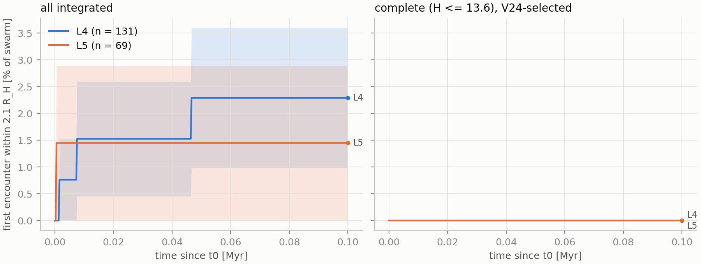
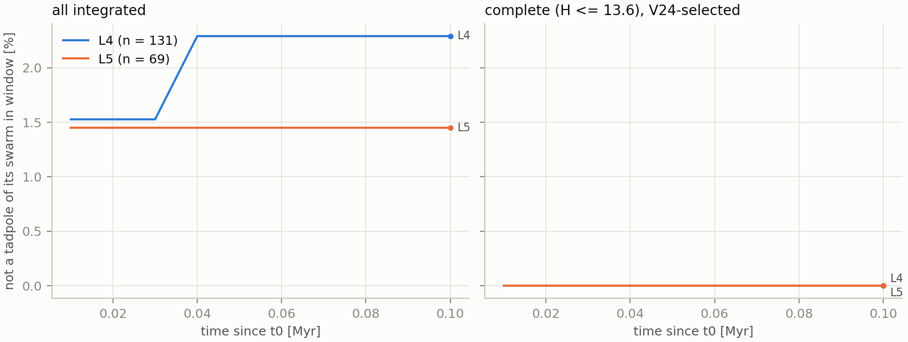
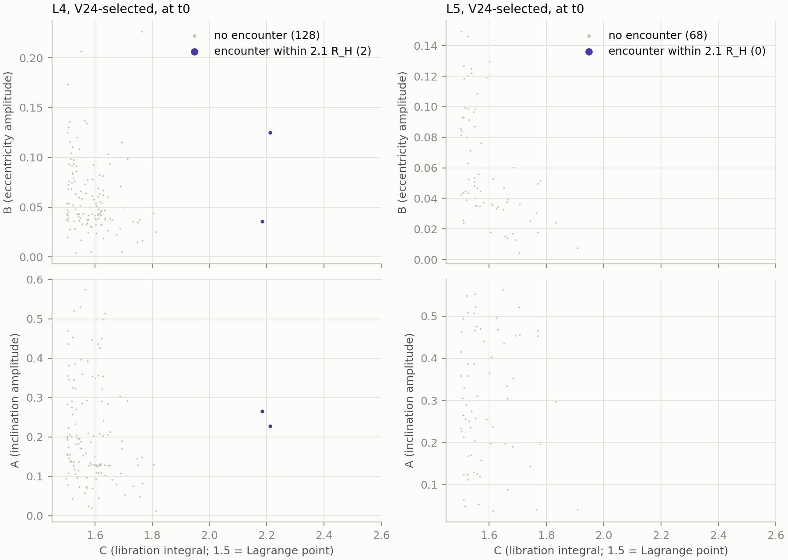

# smoke

200 Trojans integrated for 0.100002 Myr (dt = 0.11861 yr, sampled every 8 steps). No clones: errors are binomial over objects and include each trajectory's chaotic scatter. This is a 0.100002 Myr run, not a 4.5 Gyr erosion rate.

## Encounters with the giants

`encounter_2.1RH`: first entry within 2.1 Hill radii (Di Sisto 2019's escape criterion). `removed_1RH`: entry within 1 Hill radius (Di Sisto 2014's), where the particle is removed.

| sample | swarm | n | encounter_2.1RH | frac_2.1RH | err_2.1RH | removed_1RH | frac_1RH |
|---|---|---|---|---|---|---|---|
| all integrated | L4 | 131 | 3 | 0.0229 | 0.0131 | 3 | 0.0229 |
| all integrated | L5 | 69 | 1 | 0.0145 | 0.0144 | 1 | 0.0145 |
| V24-selected | L4 | 130 | 2 | 0.0154 | 0.0108 | 2 | 0.0154 |
| V24-selected | L5 | 68 | 0 | 0.0000 | 0.0000 | 0 | 0.0000 |
| complete (H <= 13.6), V24-selected | L4 | 29 | 0 | 0.0000 | 0.0000 | 0 | 0.0000 |
| complete (H <= 13.6), V24-selected | L5 | 19 | 0 | 0.0000 | 0.0000 | 0 | 0.0000 |
| Di Sisto 2013 numbered | L4 | 32 | 0 | 0.0000 | 0.0000 | 0 | 0.0000 |
| Di Sisto 2013 numbered | L5 | 15 | 0 | 0.0000 | 0.0000 | 0 | 0.0000 |

## Libration over the first 1 Myr (V24's cleaning step, per label definition)

`failed_1myr`: at least one 10 kyr window in the first 1 Myr in which the object was not a tadpole of its t0 swarm (including removal).

| label_region | swarm | n | failed_1myr | of_which_removed |
|---|---|---|---|---|
| JPL | L4 | 1 | 1 | 1 |
| MPC | L5 | 1 | 1 | 1 |
| V24+JPL | L4 | 6 | 0 | 0 |
| V24+JPL+MPC | L4 | 124 | 2 | 2 |
| V24+JPL+MPC | L5 | 68 | 0 | 0 |

## Cost

0.0 CPU-h in total; 3.18 CPU-s per Trojan-Myr; longest chunk session 0.0 h wall. Naive projection to 4.5 Gyr for this many Trojans (no removals): 0.1 CPU-yr.
