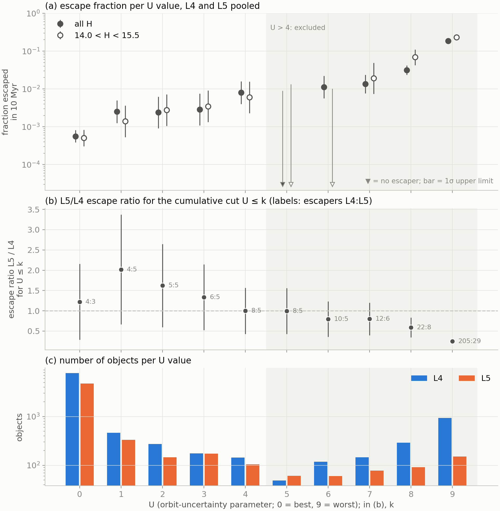
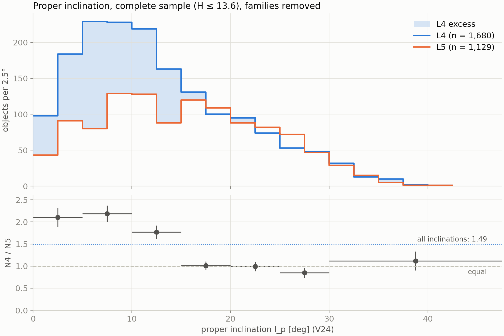
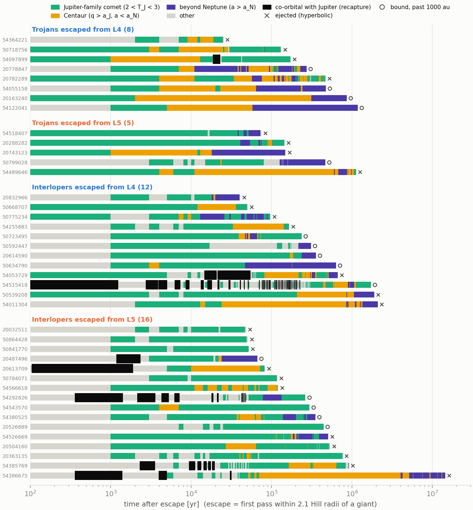

# The L4/L5 asymmetry is an initial condition, not erosion

Written 2026-10-07 for Simon. Numbers come from the 10 Myr pilot
(`campaign/reports/pilot_10myr/`); each one's source is given next to it.

**Claim.** L4's excess is an extra population of cold (I_p < 15°) L4 Trojans. Today's
dynamics erode both swarms equally and can't build it, so it was set at capture.

---

## 1. The U ladder

The definition of U is: 

`RUNOFF = (dT·e + 10/P·dP) · k₀/P · 3600 · 3     [arcsec per decade]`

`U      = INT( ln(RUNOFF) / (ln(648000)/9) ) + 1,   0 ≤ U ≤ 9`

it quantifies the uncertainties of trojan's orbit comparing to its fitted value by using dT and dP, which derives from its observation arc. It is not related to the apsidal motion of trojans, since they are all compared against the same P as the Jupiter. 

U turns dT and dP, the *fit* errors in perihelion time and period, into the 3σ drift along the orbit after 10 years. Each step is a factor of 4.42.

**The U ladder tests the cut** (`uladder.csv`, figure below).
- Escape fraction in 10 Myr, L4 and L5 pooled:

  | U | 0 | 1–4 | 6–7 | 8 | 9 |
  |---|---|---|---|---|---|
  | Escaped in 10 Myr | 0.06% | 0.2–0.8% | ≈ 1% | 3% | 19% |

- The L5/L4 escape ratio is consistent with 1 for every cut up to U ≤ 7 (1.00 ± 0.57 at U ≤ 4). See detailed population distribution (cdf/pdf) in following section. 

**Interlopers removed.** 28 comet-like objects (12 L4, 16 L5) in V24's box but on neither the JPL nor the MPC list all left within a few kyr. They alone produced the earlier "L5/L4 = 1.67 ± 0.52" (`INITIAL_CONDITIONS_KS.md` §3). So we suspect the escape ratio are not the ones with confirmed trojan identities. V24 themselves said their method only applies for 10Myr stability test, "although longer simulation could remove more of them, they find it sufficient for this study". These escapers are probably among those. 

**Working samples: entire population distribution**

| Sample | N(L4) | N(L5) | N4/N5 |
|---|---|---|---|
| U ≤ 4, Trojans by V24 *and* JPL/MPC (dynamics) | 8,803 | 5,512 | 1.60 |
| Complete, H ≤ 13.6, V24-selected (distributions) | 1,836 | 1,213 | 1.51 |

Note: n the complete sample only 1 of its 3,049 objects has U ≥ 5.

## 2. The hypothesis: a calm system can't make L4 differ from L5

(`TIME_SYMMETRY_HYPOTHESIS.md` §1–2, §6)

- By the assumption of mirroring (dN4_in/dt = dN5_out/dt, vise versa?) and steady state (dN5_in/dt = dN5_out/dt, dN4_in/dt = dN5_out/dt), the 4 rate should be the same and lead to an equal population of L4 and L5, which is different from what we have observed (8,803 vs 5,512). 
This asymmetry, proven by both the analytic and statistic simulation, infers that there must be some initial condition leads an excess in L4, while not caused by the erosion rate's difference. 

## 3. Current L4 L5 population distribution. 

**N4/N5 by proper inclination** (complete sample, families removed;
`ratio_by_inclination.csv`):

| I_p | N4 | N5 | N4/N5 |
|---|---|---|---|
| < 15° | 1,121 | 559 | **2.01 ± 0.10** |
| ≥ 15° | 559 | 570 | **0.98 ± 0.06** |
| 0–10° | 739 | 343 | 2.15 ± 0.14 |
| 10–20° | 613 | 445 | 1.38 ± 0.09 |
| 20–30° | 270 | 289 | 0.93 ± 0.08 |
| > 30° | 58 | 52 | 1.12 ± 0.21 |

We have run KS-test on e, i and D, and the result indicate the generally more inclined L5, while e and D remains homogenusly distributed among L4 and L5. Binning the population by i, instead of an excess in high inclination L5, there is an excess in lower inclined L4 population, which is different from initial assumption. 

Pirani's Jupiter migration test has never ruled out the probability that erosion itself is symmetric or not. They also does not have a welly defined Trojans: anything within 2.5 Hill radii including quasi-satellite orbits and horseshoe are considered trojan. Their trojans have i from 0.01-1 deg and too much mass. 

## 4. Erosion today is symmetric

**10 Myr, U ≤ 4** (`escape_split.csv`, `ratios.csv`): 8 of 8,803 escape from L4 and
5 of 5,512 from L5, so Ṅ/N = 0.91 per 10⁴ Trojans per Myr in both. The escape ratio is
1.00 ± 0.57; the amplifier S4/S5 (the factor applied to N4/N5) is 1.0015 ± 0.0010.

**Ṅ per U class** (`s3_ndot_by_u.py` → `ndot_by_u.csv`; escapes per 10⁴ Trojans per Myr, 1σ Wilson interval):

| U | n L4 / L5 | k L4 / L5 | Ṅ/N L4 | Ṅ/N L5 | L5/L4 |
|---|---|---|---|---|---|
| 0 | 7,749 / 4,755 | 4 / 3 | 0.52 (0.32–0.85) | 0.63 (0.36–1.1) | 1.22 ± 0.93 |
| 1–4 | 1,054 / 757 | 4 / 2 | 3.8 (2.3–6.2) | 2.6 (1.3–5.3) | 0.70 ± 0.60 |
| **≤ 4** | 8,803 / 5,512 | 8 / 5 | **0.91 (0.64–1.3)** | **0.91 (0.58–1.4)** | **1.00 ± 0.57** |
| 5–7 | 312 / 199 | 4 / 1 | 13 (7.8–21) | 5.0 (1.9–13) | 0.39 ± 0.44 |
| 8 | 290 / 91 | 10 / 2 | 35 (25–47) | 22 (11–43) | 0.64 ± 0.49 |
| 9 | 939 / 151 | 183 / 21 | 195 (182–208) | 139 (113–170) | 0.71 ± 0.15 |

- **L4 and L5 agree within errors in every class up to U = 8.** U = 9 (0.71 ± 0.15) is
  orbit error: those orbits are essentially unknown.
- From U ≥ 5, Ṅ rises because the fit worsens. Why U = 1–4 escapes faster than U = 0
  is untested; they are later, hotter discoveries (median I 17° against 11°).

**Over the age of the Solar System.** Di Sisto's 4.5 Gyr amplifiers are
1.071 ± 0.025 (2014) and 1.020 ± 0.023 (2019). Erosion would need 1.5–1.6 overall and
2.0 in the cold bin.

**Fates** (`escaper_fates_pilot/report.md`): all 41 escapers leave the planetary region
(median 0.3 Myr; 26 hyperbolic, 15 bound beyond 1000 au). 8 are recaptured as
co-orbitals for 1–120 kyr, some into the opposite swarm, and none stays. Today's exchange
reaches only the chaotic fringe, not a long-lived cold core.

## 5. Conclusion

1. The asymmetry is measured on samples that are well determined (U ≤ 4) and complete
   (H ≤ 13.6).
2. A calm system keeps L4 = L5 by symmetry.
3. The data show L4 = L5 *except* for an extra 562 cold L4 objects.
4. Present-day loss is equal per object in both swarms. Over 4.5 Gyr erosion changes
   N4/N5 by ≤ 7%, against the factor 2 needed at I < 15°.

**So the asymmetry is an initial condition, laid down by a mirror-odd forcing.** The
next question is which forcing makes extra *cold* L4 objects. Jupiter's migration is the
natural candidate (its sign follows the direction of migration; Pirani 2019a). Li et al.
2023a is disfavoured: it predicts smaller L4 libration amplitudes, and the data show
none (V24 p = 0.17; ours p = 0.11–0.33).

## 6. Discussion

- Erosion hasn't been measured by inclination (Di Sisto's isn't split by I). A 4.5 Gyr
  run split by inclination, or a symmetric-start control, would close this gap.
- The symmetry is exact only in the restricted problem; the outer giants break it
  slightly.
